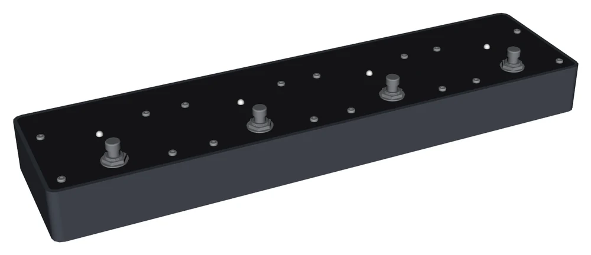
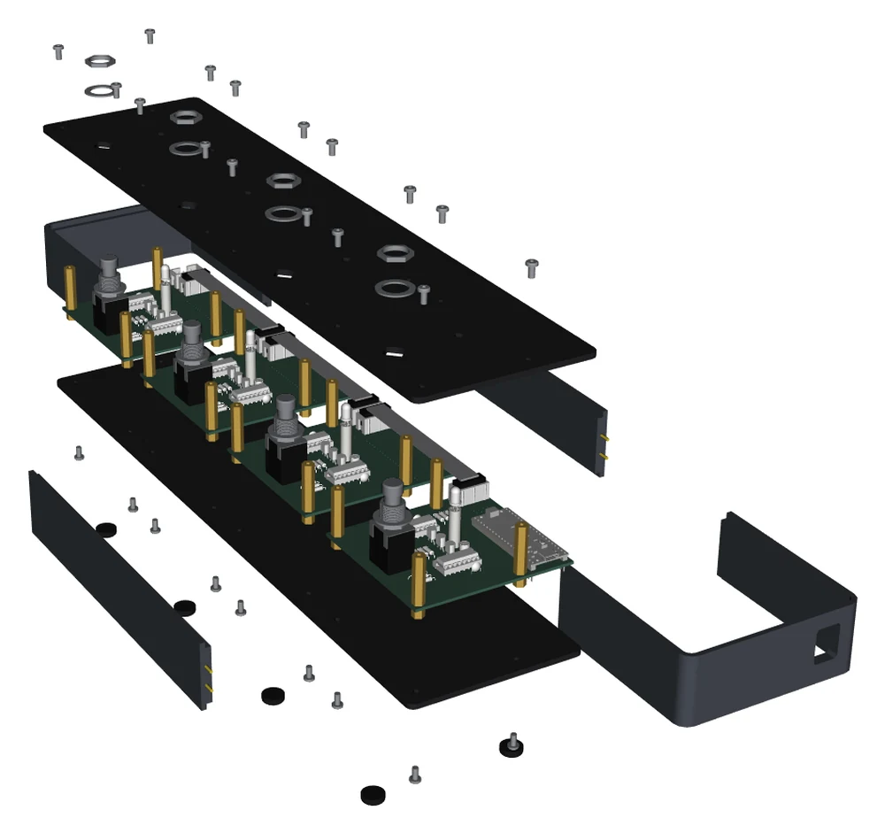

# Footswitches

A modular USB MIDI footswitch controller. Each module is one PCB with a footswitch and an RGB
LED, and modules chain together with ribbon cables. The first module carries a Raspberry Pi
Pico, which is the USB MIDI device. All parts are through-hole. Firmware and host tools are in Rust.

- [docs/build.md](docs/build.md) ([PDF](docs/build.pdf)): build instructions
- [docs/design.md](docs/design.md): board and enclosure design
- [docs/bom.md](docs/bom.md): parts list
- [docs/firmware.md](docs/firmware.md): firmware, driver and the `fsctl` tool
- `pcb/`: KiCad project. `mech/`: plates, walls and 3D assembly. `firmware/`, `driver/`, `core/`: Rust code.

--- 

Basically all of this is AI generated. Let's see if this thing actually works.