<!-- Generated by pcb/scripts/build_docs.py. Edit that script, not this file. -->
# Build instructions

Every board is the same PCB. The **main board** gets a Pico and four extra resistors, and
only one of the two chain connectors. **Extension boards** get both connectors, but no Pico.

All parts go on the **top side** (the side with the white labels). Solder on the bottom.
Build from the lowest parts to the tallest, so the board lies flat on its parts while you
solder.

**Board orientation used below:** labels readable, Pico area at the top, footswitch at the
bottom. The pictures look at the board from the bottom edge. In each picture, the parts of
that step are outlined.

## Tools

Soldering iron, solder, side cutters, multimeter. A vise or IDC crimp tool for the cables.

---

## Main board

### Step 1: 10 kΩ resistors, left bank

| Part | Qty | Where |
|------|-----|-------|
| 10 kΩ resistor: brown-black-orange (4 bands) or brown-black-black-red (5 bands) | 2 | R4, R9 |

1. Bend the leads and push the resistors into both positions of the **left resistor bank**,
   left of the footswitch.
2. Solder. Cut the leads.

They are the same value, and direction doesn't matter.

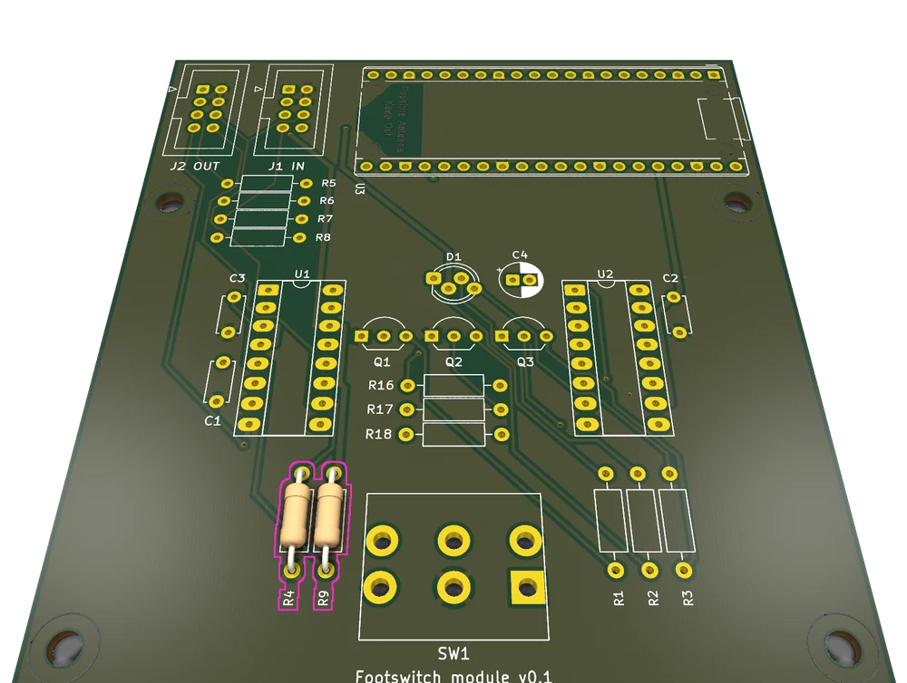

### Step 2: LED resistors, right bank

| Part | Qty | Where |
|------|-----|-------|
| 560 Ω resistor: green-blue-brown (4 bands) or green-blue-black-black (5 bands) | 1 | R1 |
| 390 Ω resistor: orange-white-brown (4 bands) or orange-white-black-black (5 bands) | 2 | R2, R3 |

1. **R1** (leftmost position of the right bank): 560 Ω.
2. **R2, R3** (the next two): 390 Ω.
3. Solder. Cut the leads.

Check the colour bands before soldering: R1 is the odd one out.

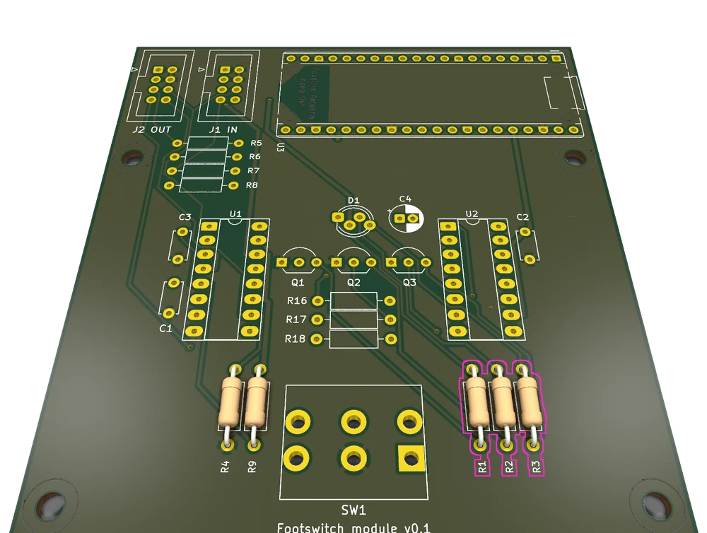

### Step 3: Transistor base resistors

| Part | Qty | Where |
|------|-----|-------|
| 4.7 kΩ resistor: yellow-violet-red (4 bands) or yellow-violet-black-brown (5 bands) | 3 | R16–R18 |

1. Fit **R16, R17, R18**, the three resistors lying across the middle of the board.
2. Solder. Cut the leads.

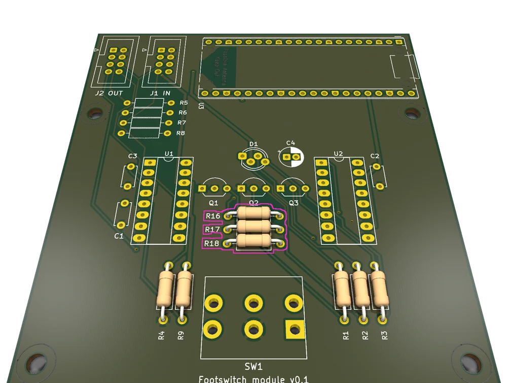

### Step 4: Pico series resistors (main board only)

| Part | Qty | Where |
|------|-----|-------|
| 33 Ω resistor: orange-orange-black (4 bands) or orange-orange-black-gold (5 bands) | 4 | R5–R8 |

1. Fit **R5–R8**, the four resistors lying flat under the `J2 OUT` / `J1 IN` labels, next to
   the Pico.
2. Solder. Cut the leads.

They are all the same value, and direction doesn't matter.

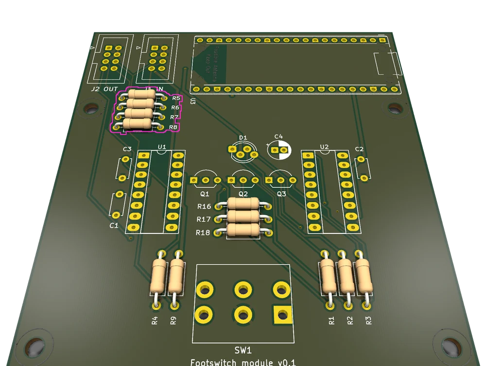

### Step 5: Ceramic capacitors

| Part | Qty | Where |
|------|-----|-------|
| 100 nF ceramic capacitor (marked `104`) | 3 | C1–C3 |

1. Fit **C3** and **C1** (left of U1) and **C2** (right of U2).
2. Solder. Cut the leads.

Direction doesn't matter.

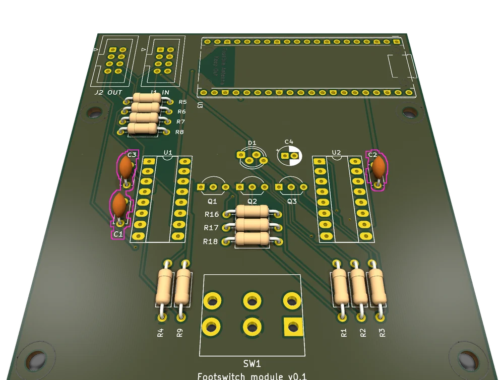

### Step 6: IC sockets

| Part | Qty | Where |
|------|-----|-------|
| 74HC165 | 1 | U1 |
| 74HC595 | 1 | U2 |
| 16-pin DIP socket | 2 |  |

1. Fit sockets at **U1** and **U2**, with the notch **up**, matching the notch in the outline.
2. Solder two opposite corner pins, check that the socket sits flat, then solder the rest.

Don't insert the chips yet.

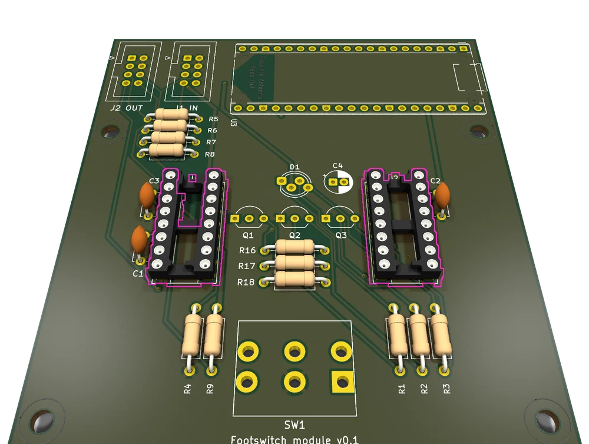

### Step 7: Transistors

| Part | Qty | Where |
|------|-----|-------|
| 2N2222A NPN transistor, TO-92 | 3 | Q1–Q3 |

1. Fit at **Q1, Q2, Q3**, with the **flat side down** (towards the footswitch), matching the
   outline. Leave a few mm of lead under the body; don't push them all the way down.
2. Solder. Cut the leads.

The footprint expects the usual pinout: emitter, base, collector from left to right, seen
from the flat side. The emitter goes in the square pad. Check the pinout of your parts first
(a multimeter's diode test finds the base: it conducts to both other leads).

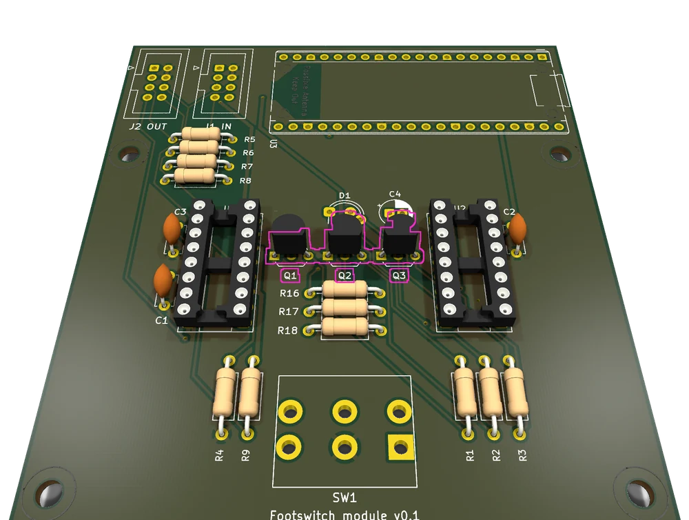

### Step 8: Electrolytic capacitor

| Part | Qty | Where |
|------|-----|-------|
| 10 µF electrolytic capacitor | 1 | C4 |

1. Fit at **C4**, right of the LED. The **long lead (+)** goes in the **square pad**, on the
   left, next to the **+** mark. The stripe on the can marks the **−** side.
2. Solder. Cut the leads.

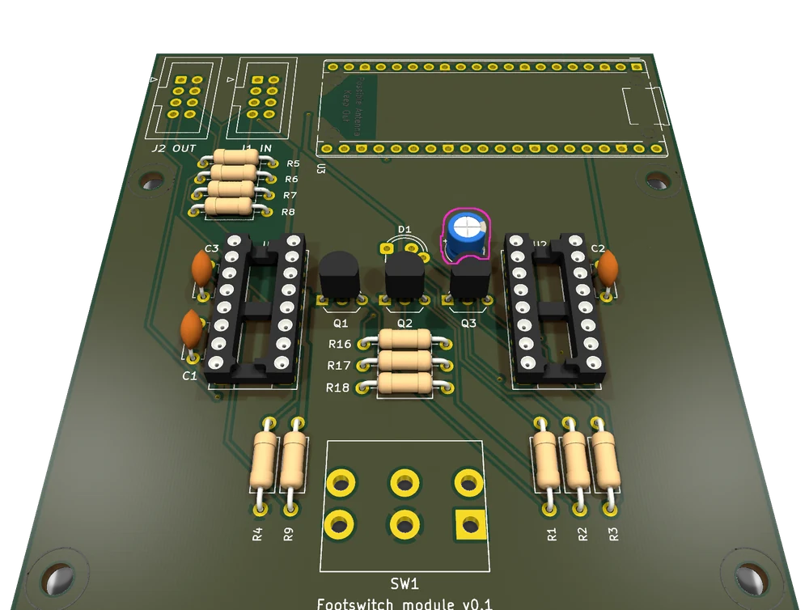

### Step 9: Chain connector

| Part | Qty | Where |
|------|-----|-------|
| 2×4 shrouded box header | 1 | J2 |

1. Fit **J2** (`OUT`, top-left corner) with the **notch** in the shroud on the **left**,
   matching the outline.
2. Solder one pin, check that it sits flat and straight, then solder the rest.

The main board gets **no J1** (`IN`, right of J2; outlined in orange): leave it empty. The
Pico drives those lines, so nothing plugs in there. Extension boards get both headers, the
same way round.

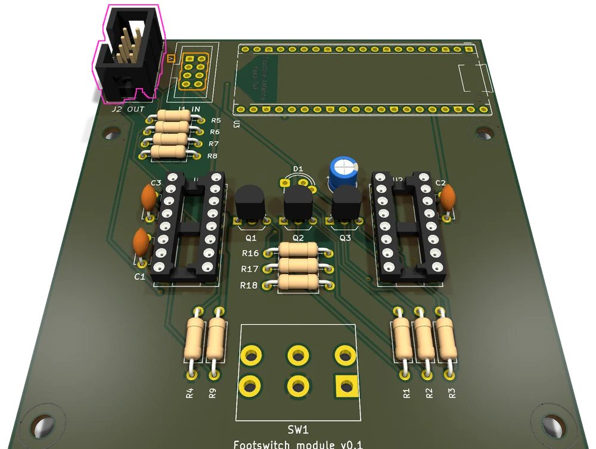

### Step 10: Pico (main board only)

| Part | Qty | Where |
|------|-----|-------|
| Raspberry Pi Pico | 1 | U3 |
| 1×20 pin header | 2 |  |
| 1×20 female socket (optional) | 2 |  |

1. *Optional:* solder the two female sockets into the **U3** rows on the board. That lets you
   take the Pico out again.
2. Push the pin headers into the board (or the sockets), long pins down. Put the Pico on top,
   **components up, USB connector at the right**, over the board edge.
3. Solder all 40 pins on top of the Pico.
4. Without sockets: also solder all 40 pins on the bottom of the board.

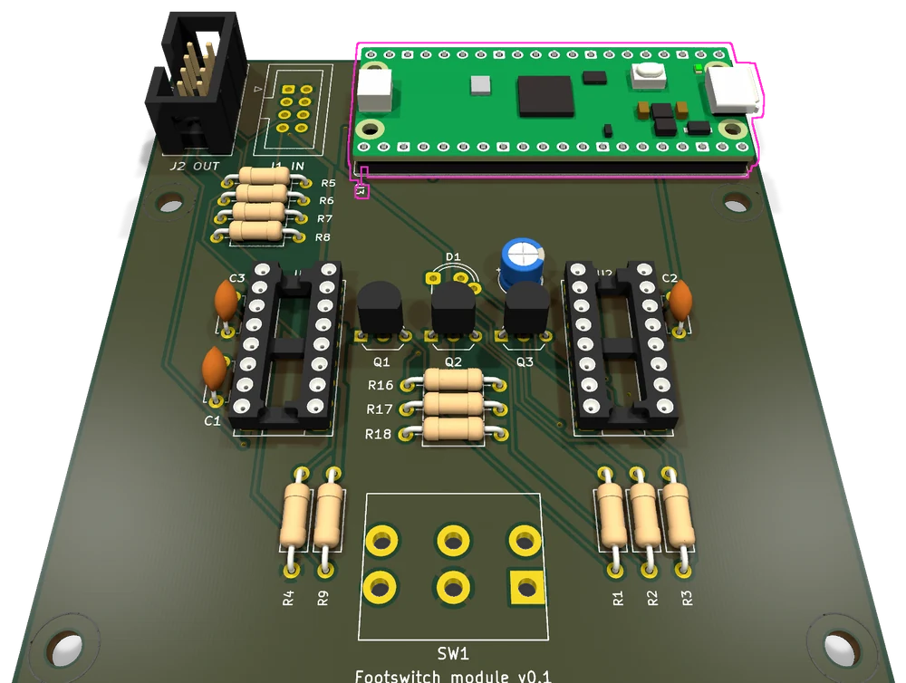

### Step 11: Power check (main board only)

1. Plug USB into the Pico. No chips are fitted yet.
2. Measure on **J2** (`OUT`; pin 1 is the square pad, top left, and pin 2 is next to it):
   - pin 1 to pin 2: about **5 V**
   - pin 3 to pin 2: about **3.3 V**
3. Unplug USB.

If either is wrong, stop and look for solder bridges.

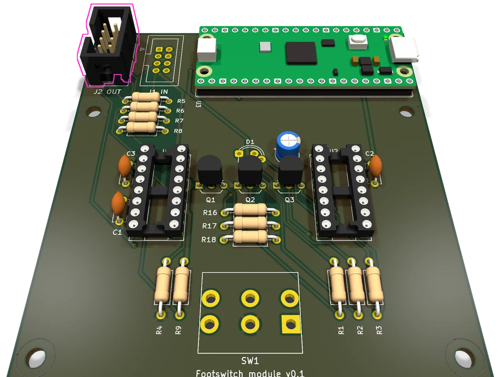

### Step 12: LED

| Part | Qty | Where |
|------|-----|-------|
| 5 mm RGB LED, 4 leads, **common anode** | 1 | D1 |
| LED spacer, 19 mm | 1 |  |

The LED must be **common anode**.

1. Slide the spacer over the leads.
2. Fit at **D1**: the **red** lead goes in the **square pad** (left), the **longest lead**
   (common anode) in the **second** hole. The holes are staggered, so bend the leads slightly
   to fit.
3. Push the spacer down to the board, check that the LED stands straight, solder, and cut the
   leads.

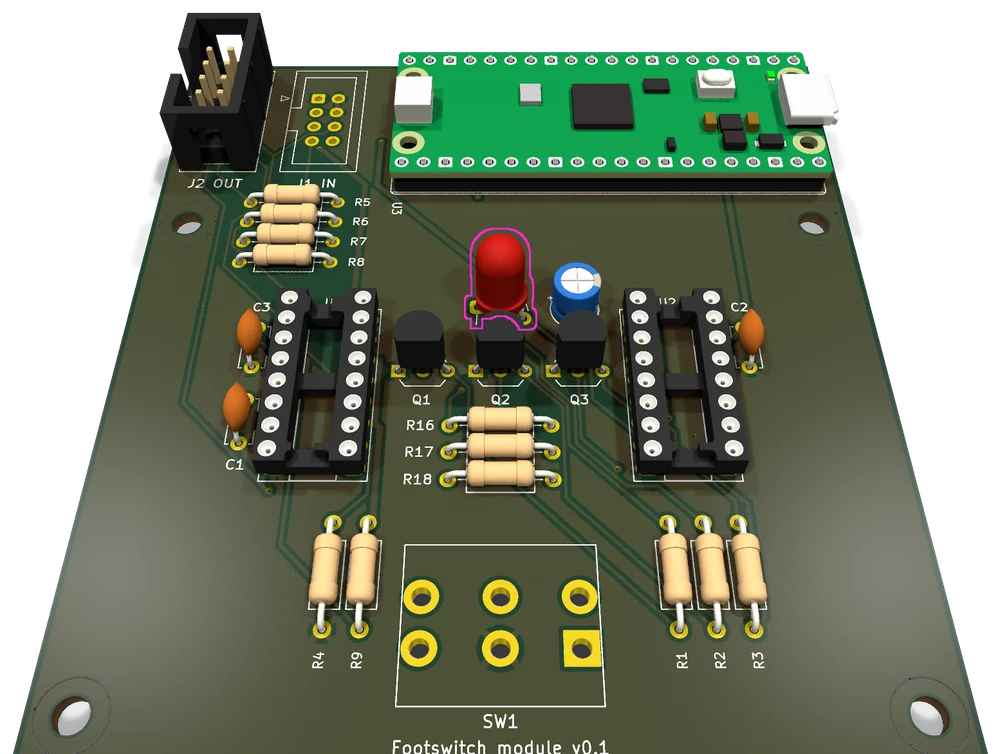

### Step 13: Footswitch

| Part | Qty | Where |
|------|-----|-------|
| PBS24-202P footswitch, momentary | 1 | SW1 |

1. Put the switch's 6 pins through **SW1**. Pin 1 of the switch goes in the **square pad**
   (bottom right).
2. Solder all 6 pins, even the unused ones: they hold the switch. Cut the pins to 3 mm or
   less: the back plate sits close under the board.
3. **Test** with the meter on the bottom row of SW1 pads, from the middle pad to the left
   pad: open when released, closed when pressed. If it's the other way round, the switch is
   turned the wrong way.

*Tip:* for a perfect fit, screw the 25 mm standoffs to the front plate and nut the switch in
first, lay the board on them, screw the short standoffs up through it (mechanical step M2),
and only then solder the switch.

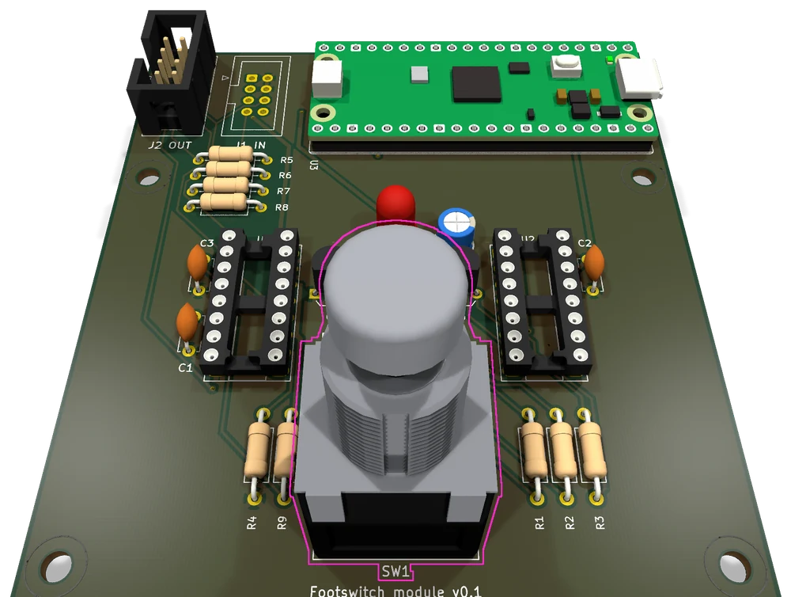

### Step 14: Chips

| Part | Qty | Where |
|------|-----|-------|
| 74HC165 | 1 | U1 |
| 74HC595 | 1 | U2 |

1. Bend the chip legs slightly inwards on a table so they fit the socket.
2. **74HC165 → U1** (left), **74HC595 → U2** (right). Notch **up**, matching the socket.
3. Press in firmly. Check that no leg folded under.

Both chips run at 3.3 V, but they do different jobs: don't swap them.

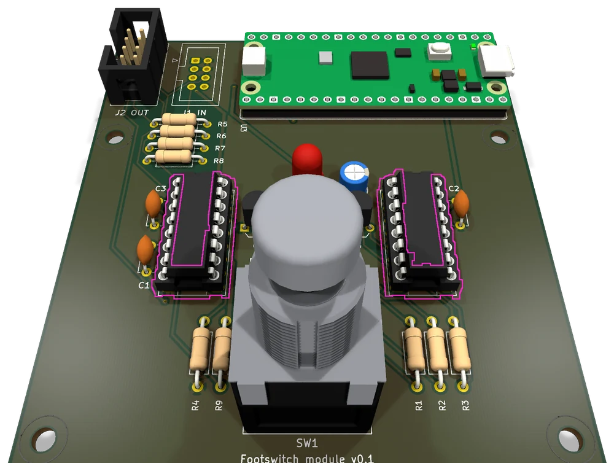

**Main board done.**

J1 stays empty (outlined).


---

## Extension board

Same PCB, same steps, but **skip steps 4, 10 and 11**. Leave R5–R8, U3 empty (outlined below), but do fit J1.

| Step | Do | Parts |
|------|----|-------|
| 1 | 10 kΩ resistors, left bank | 2 × 10 kΩ resistor |
| 2 | LED resistors, right bank | 1 × 560 Ω resistor, 2 × 390 Ω resistor |
| 3 | Transistor base resistors | 3 × 4.7 kΩ resistor |
| ~~4~~ | ~~Pico series resistors (main board only)~~ | skip |
| 5 | Ceramic capacitors | 3 × 100 nF ceramic capacitor (marked `104`) |
| 6 | IC sockets | 1 × 74HC165, 1 × 74HC595, 2 × 16-pin DIP socket |
| 7 | Transistors | 3 × 2N2222A NPN transistor, TO-92 |
| 8 | Electrolytic capacitor | 1 × 10 µF electrolytic capacitor |
| 9 | Chain connector | 2 × 2×4 shrouded box header |
| ~~10~~ | ~~Pico (main board only)~~ | skip |
| ~~11~~ | ~~Power check (main board only)~~ | skip |
| 12 | LED | 1 × 5 mm RGB LED, 4 leads, **common anode**, 1 × LED spacer, 19 mm |
| 13 | Footswitch | 1 × PBS24-202P footswitch, momentary |
| 14 | Chips | 1 × 74HC165, 1 × 74HC595 |

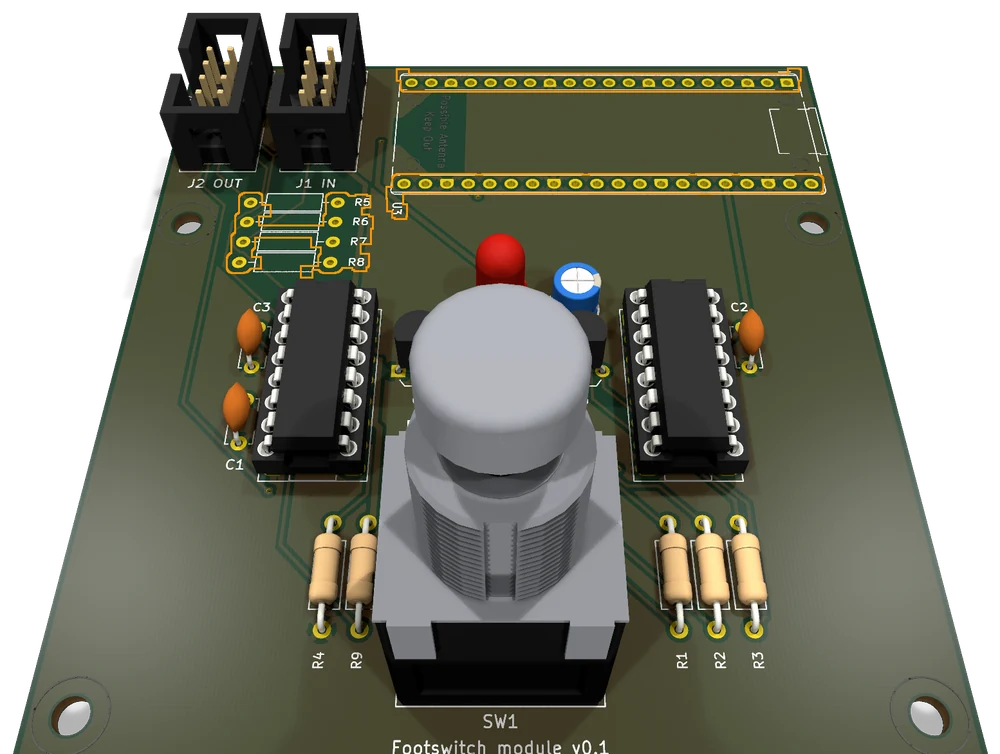

**Repeat for every extension board.**

---

## Cables and chaining

### Make a ribbon cable

| Part | Qty per cable |
|------|---------------|
| 2×4 IDC socket | 2 |
| 8-way ribbon, about 10 cm (OUT to the next IN is 88 mm, centre to centre) | 1 |

1. Cut the ribbon square.
2. Lay it in the IDC socket, with the **red wire on the pin 1 side** (marked ▼ on the socket).
3. Squeeze it closed in a vise until flat. Fit the strain-relief clip.
4. Do the same at the other end, **the same way round** (red wire on pin 1 at both ends).

**Repeat:** one cable per extension board.

### Connect

```
[Extension 2] IN ◄──cable── OUT [Extension 1] IN ◄──cable── OUT [Main board]
```

1. Main board **OUT** (J2, top-left corner) → **IN** (J1, the header right of OUT) of the
   first extension board, to its left. The cable runs straight along the top edge.
2. That board's **OUT** → the next board's **IN**. Repeat.
3. The last board's OUT stays empty. (The main board has no IN.)
4. Plug USB into the Pico. Check J2 (OUT, empty) on the **last** board: pin 1 to pin 2 ≈ 5 V,
   pin 3 to pin 2 ≈ 3.3 V.

---

## Mechanical assembly (4 buttons)

The unit is a sandwich: the boards sit on the back plate, and the front plate sits on the
standoff columns. The sides stay open, or get the printed walls in the last section. The steps below are for 4 buttons: one main board
and 3 extension boards. For more buttons, use the longer plates and more of the same
hardware per board.

**Orientation:** footswitches towards you, the main board (with the Pico) at the right-hand
end. In each picture, the parts of that step are outlined.

**Tools:** 2 mm hex key (or the driver for your screws), 14 mm spanner.

### Step M1: Get the boards ready

| Part | Qty |
|------|-----|
| main board (with the Pico), built | 1 |
| extension board, built | 3 |

Every board must be fully built, with its chips in and the LED on its spacer.

1. Lay the boards out in a row, **footswitches towards you**: the **main board at the right
   end** (its USB connector points off the right edge), the 3 extension boards to its left.
2. Check that every lead under the boards is cut to **3 mm or less**, including
   the footswitch and Pico pins. The back plate sits 5 mm under the boards.
3. Peel the protective film off both plates, if they have one.

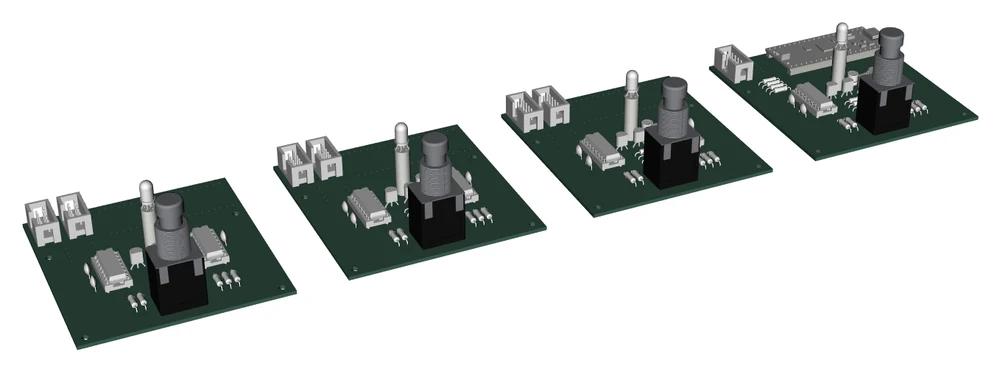

### Step M2: Standoffs

| Part | Qty |
|------|-----|
| M3 hex standoff, male-female, 5 mm + 6 mm stud | 16 |
| M3 hex standoff, female-female, 25 mm | 16 |

Each of the four mounting holes in the board corners gets a column of two standoffs: a short
one under the board, and a long one on top, screwed onto the short one's stud.

1. From the **underside**, push a **short standoff**'s stud up through a mounting hole. The
   body stays under the board.
2. On top, screw a **25 mm standoff** onto the stud, finger tight.
3. Do the other three holes, then tighten each pair: hold the short one with a 5.5 mm
   spanner or pliers and turn the long one. Not too hard: the thread is brass.

Do this on every board. Check that no column has a gap at the board: the standoffs clamp it.

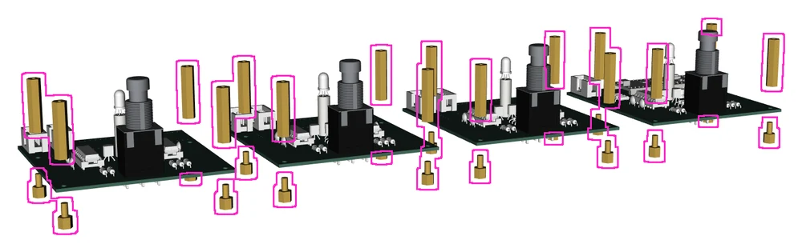

### Step M3: Lower switch nuts

| Part | Qty |
|------|-----|
| M12 nut and washer, from the switch | 4 |

Each footswitch comes with two nuts and two washers. The first nut and washer go on now,
under the front plate. They set the switch height.

1. Take the nuts and washers off the switch thread.
2. Run one nut down the thread, then one washer on top of it.
3. Turn the nut until the **top of the washer is level with the tops of the 25 mm
   standoffs** (lay a ruler across the standoffs). That is about 4.4 mm
   above the switch body.

Do this on every board. Keep the other nut and washer for later.

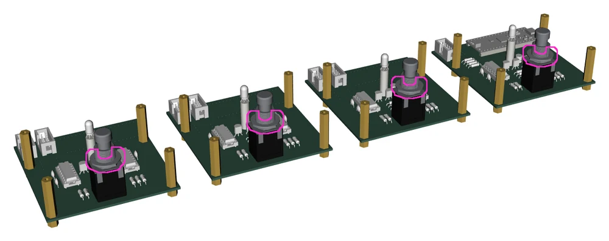

### Step M4: Boards on the back plate

| Part | Qty |
|------|-----|
| back plate (only the small holes) | 1 |
| M3 × 6 mm button head screw | 16 |

1. Lay the back plate across two blocks or books, or let it stick out over the edge of the
   bench, so you can get at the holes from underneath.
2. Put each board on the plate, in the same order as in step M1. The short standoffs' bodies
   stand on the plate, over its holes.
3. From underneath, screw an **M3 × 6** screw up through the plate into every short standoff
   (16 in all). Leave them a little loose until all are in, then tighten them.

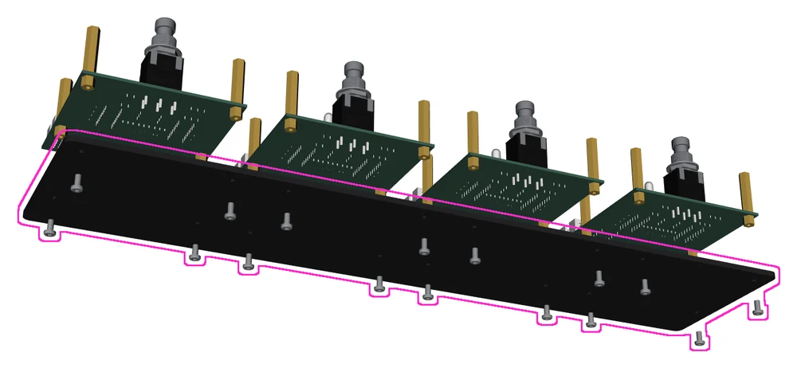

### Step M5: Chain cables

| Part | Qty |
|------|-----|
| chain cable (see *Make a ribbon cable* above) | 3 |

The connectors are on the back edge of each board (the edge away from you).

1. Plug a cable into the main board's **OUT** (J2, its only chain header) and the other end
   into the **IN** (J1, the right one of the two headers) of the extension board to its left.
2. Do the same from each extension board's **OUT** to the next board's **IN**.
3. The leftmost board's OUT stays empty.

The cable lies flat along the back edge, a little slack between the sockets.

**Flash and test now**, before the front plate goes on. The first flash needs the Pico's
BOOTSEL button, which the front plate covers (see `docs/firmware.md`). Then press each switch:
its LED should light.

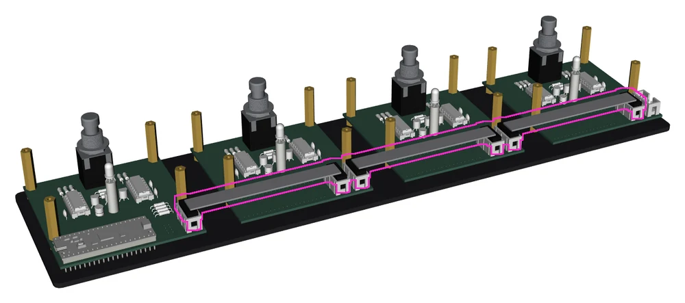

### Step M6: Front plate

| Part | Qty |
|------|-----|
| front plate (big switch holes, LED holes) | 1 |

1. Lower the front plate onto the standoffs: the switch threads go through the big holes,
   the LEDs into the small ones.
2. It rests on the standoffs and the lower switch washers. If it rocks, a lower nut is set
   too high: take the plate off and turn that nut down a little.

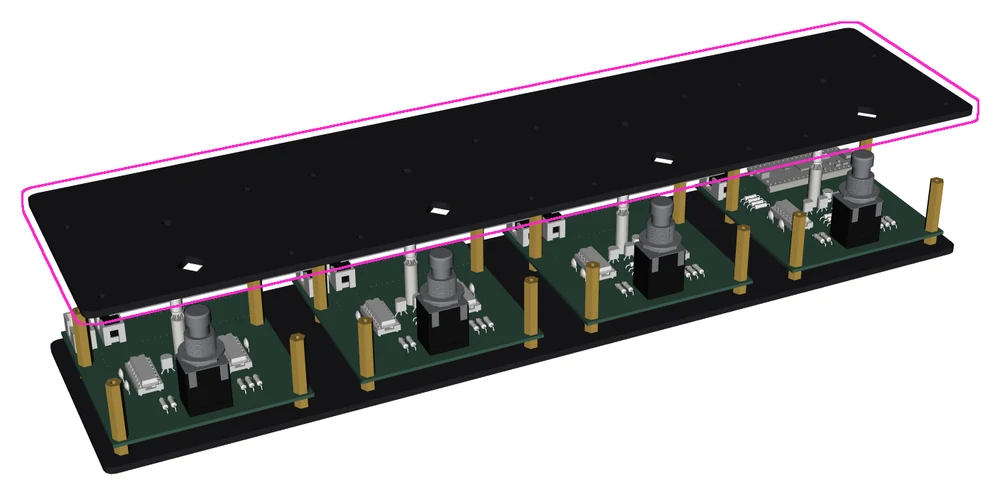

### Step M7: Top screws and switch nuts

| Part | Qty |
|------|-----|
| M3 × 6 mm button head screw | 16 |
| M12 nut and washer, from the switch | 4 |

1. Screw an **M3 × 6** screw through the plate into every standoff (16 in all). Snug,
   not tight: the plate is acrylic.
2. On each switch: the second washer, then the second nut, on top of the plate. Tighten the
   nut by hand, then a quarter turn with a 14 mm spanner, holding the switch straight.

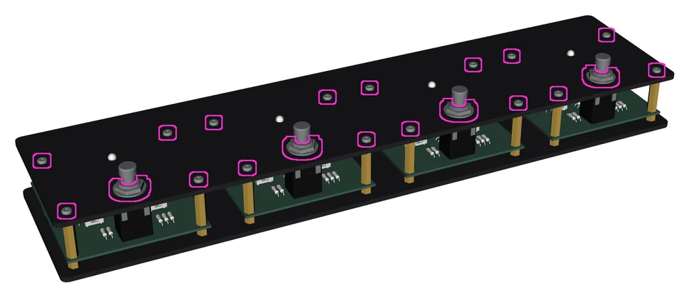

### Step M8: Feet

| Part | Qty |
|------|-----|
| rubber foot, stick-on, 12 mm | 8 |

1. Turn the unit over onto a towel.
2. Stick a foot under each switch, near the front edge, and one behind it, near the back
   edge. They sit between the screw heads: the stomp goes straight down into them.

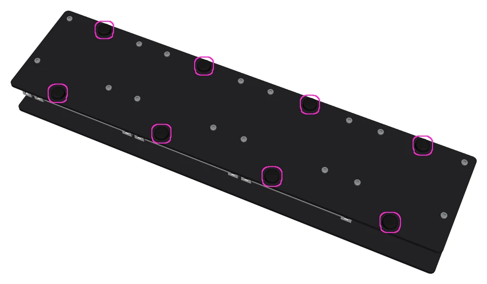

### Step M9: Done

Turn it back over and plug USB into the Pico, at the right-hand end.

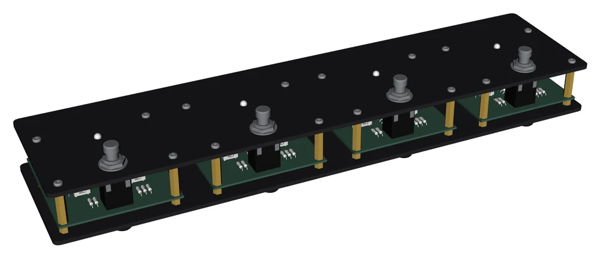

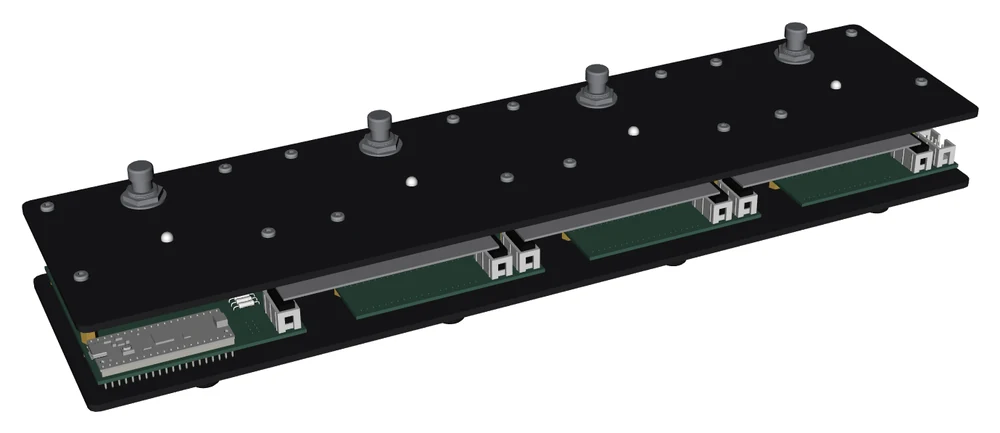

---

## Side walls (optional)

Printed walls close the open sides. They go on a finished unit, or during the build after
step M5. The plates don't change: the walls hook over the plate edges, and the plates hold
them in place once the front plate is screwed down.

**Printing:** run `uv run --group dev mech/walls.py N` for N buttons and print the STLs from
`mech/out/` upright, as they come, without supports. PETG or PLA, 3 perimeters. The same pieces
fit any number of buttons: two end caps and 2N − 4 straight pieces. Print one end cap first and
try it on the back plate's edge: the plate should drop into the step with a little play.

**Tools:** as above, plus a 2 mm drill bit and side cutters for the pins.

### Step W1: Take the front plate off

The walls hook over the edges of both plates, so the front plate has to come off. If you are
building a new unit, fit the walls after step M5 instead, and skip this step.

1. Take the top nut and washer off each switch (14 mm spanner).
2. Unscrew the 16 M3 × 6 screws from the front plate.
3. Lift the front plate off. The boards stay screwed to the back plate.

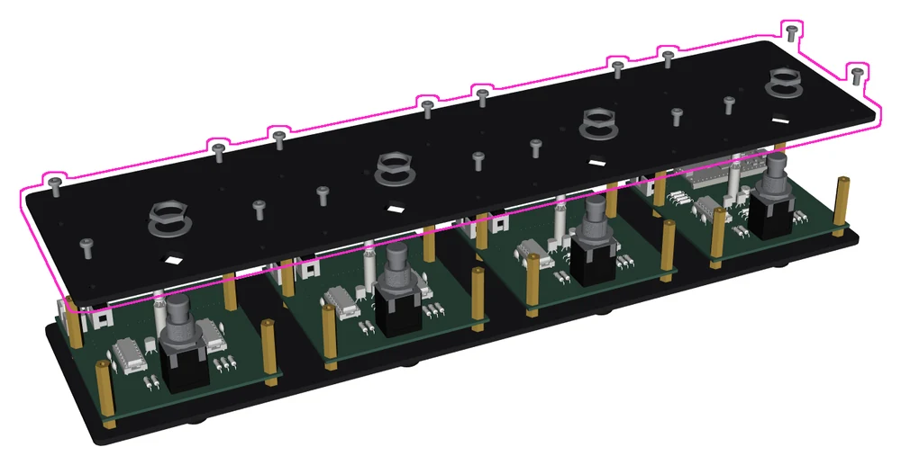

### Step W2: Walls around the back plate

| Part | Qty |
|------|-----|
| wall end cap, left (`walls_N_end_left.stl`) | 1 |
| wall end cap, right, with the USB cutout (`walls_N_end_right.stl`) | 1 |
| wall, straight (`walls_N_straight.stl`) | 4 |
| alignment pin: 1.75 mm filament, 11 mm long | 12 |

Each wall has a step along its top and bottom inside edge. The edge of the back plate sits in
the bottom step, the front plate's edge in the top one.

1. Clean the stringing out of the pin holes at the ends of the pieces. A 2 mm drill, turned by
   hand, does it.
2. Cut 12 pins of 11 mm from 1.75 mm filament. Push two into the
   holes at **both ends of the end caps' arms**, halfway in.
3. Hook the **right end cap** (the one with the USB cutout) over the right-hand end of the
   back plate. The plate's edge goes into its bottom step, and the USB port lines up with
   the cutout. Then the **left end cap** at the left-hand end.
4. Fit the 4 straight pieces along the front and back edges, from one end to the
   other. Push each one onto the pins of the piece before it, then put two pins in its free
   end for the next one.
5. Check that the frame sits flat on the bench all round, with the back plate's edge in the
   step everywhere. If a piece won't close up, trim the pin a little.

Until the front plate is on, the straight pieces can fall outwards. A strip of tape across
each joint holds them.

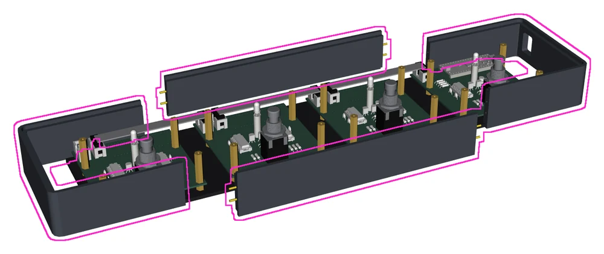

### Step W3: Front plate back on

1. Lower the front plate onto the standoffs, as in step M6. Its edge drops into the top step
   of the walls all round. If it catches, find the piece that has moved out of line and push
   it back in.
2. Screw it down with the 16 M3 × 6 screws, and put the top washers and nuts back
   on the switches, as in step M7. Take any tape off.

The plates now hold the walls: there is no need for glue. The walls are slightly shorter than
the standoffs, so the screws still clamp on the standoffs, not on the walls.

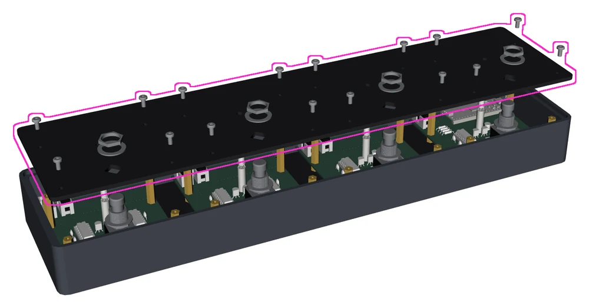

### Step W4: Done

USB goes in through the cutout in the right-hand end cap.

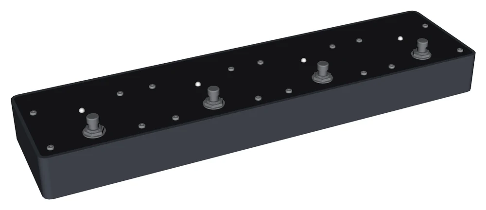

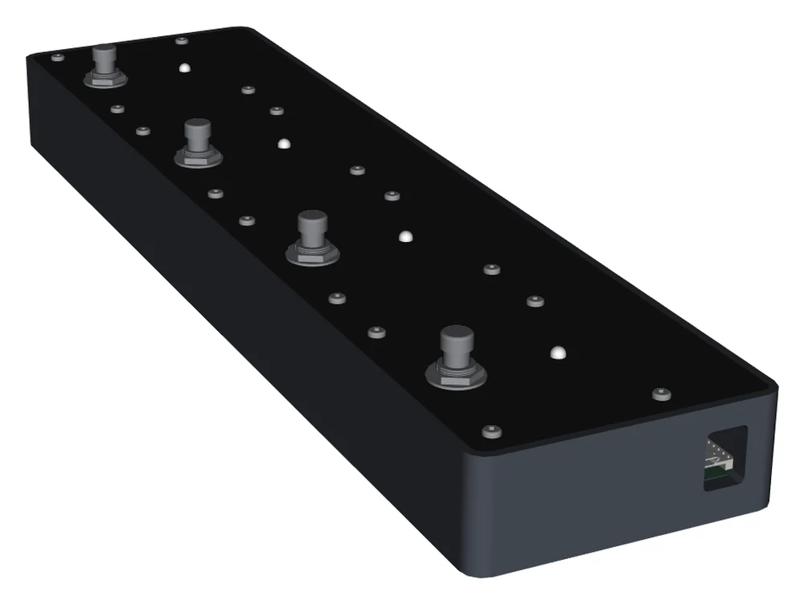
